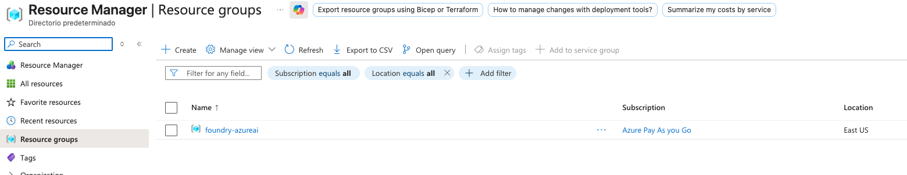
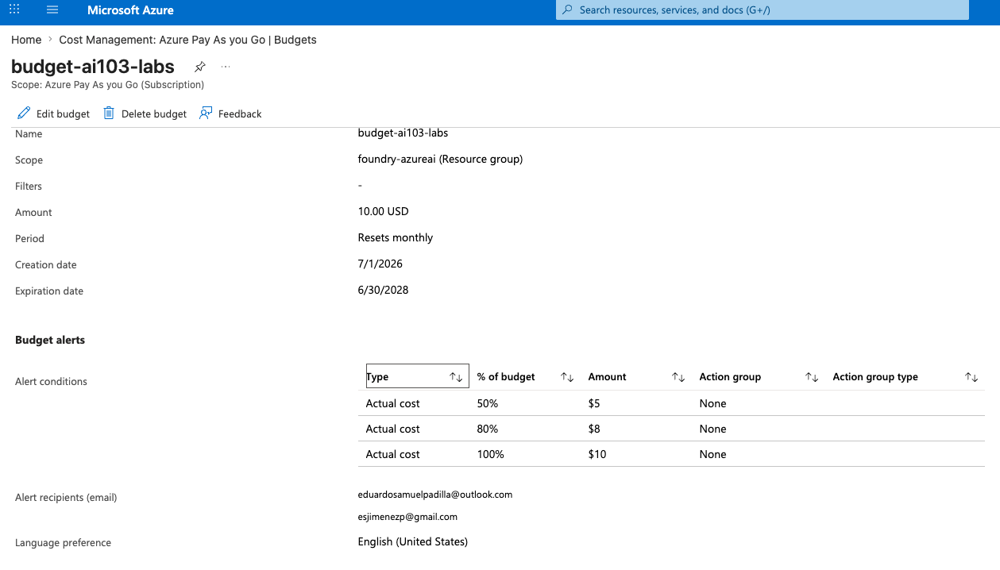
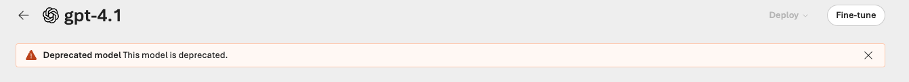
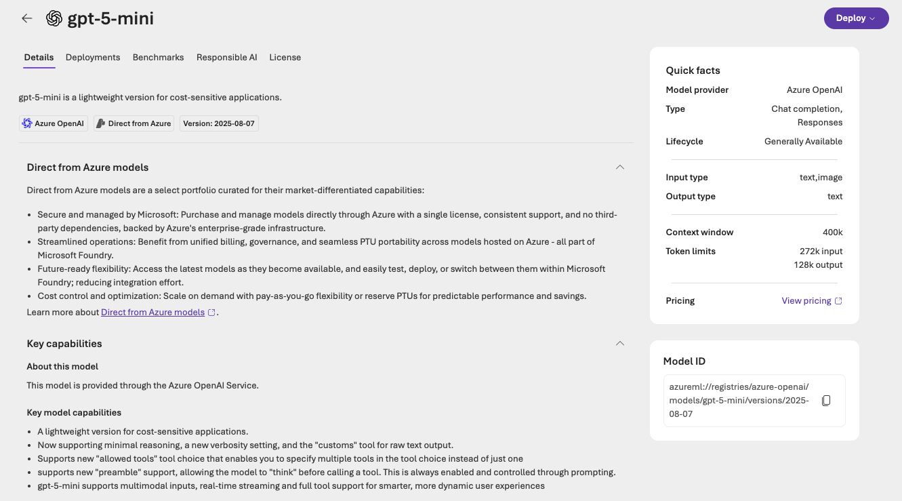
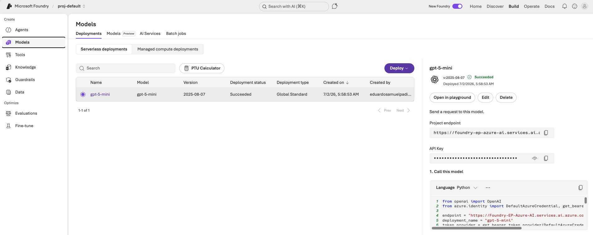
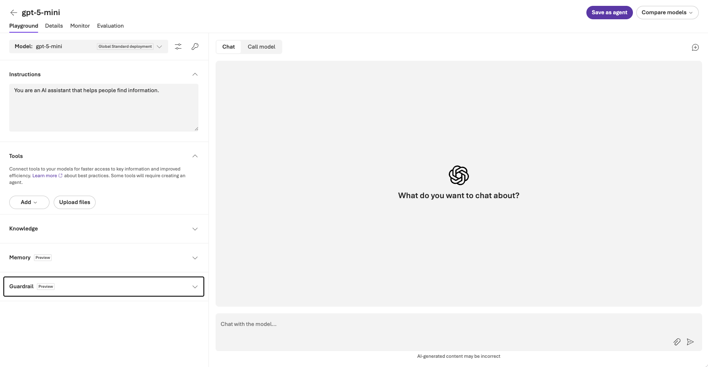
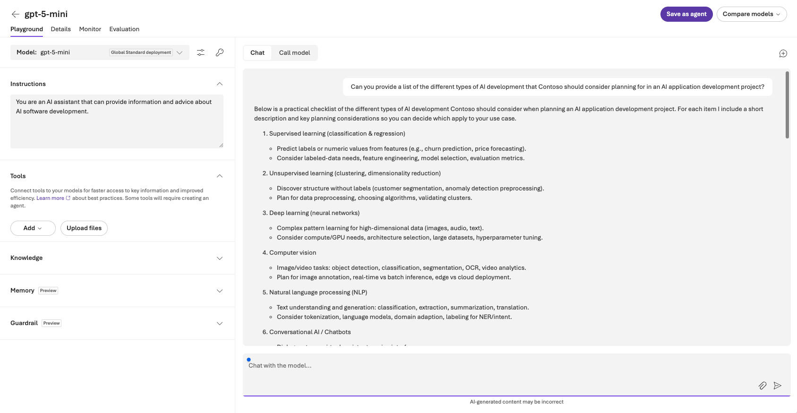
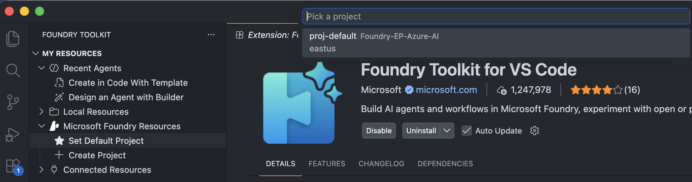
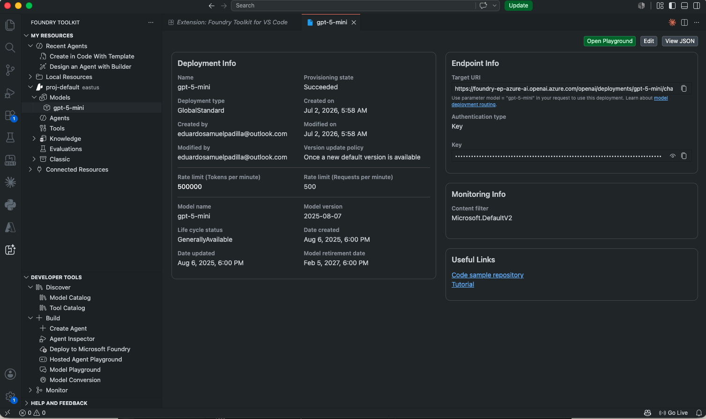
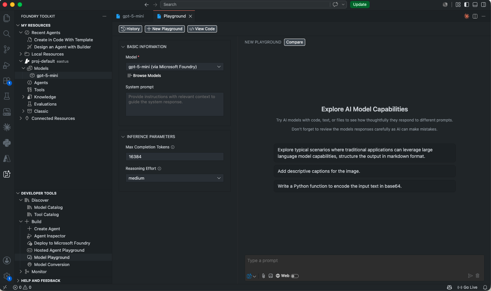

# Exercise 01: Prepare for an AI Development Project 🧭

[#exercise-01-prepare-for-an-ai-development-project](#exercise-01-prepare-for-an-ai-development-project)

Hands-on walkthrough of **Azure AI Foundry** project setup, model deployment, and testing.

This lab focuses on the **portal + tooling fundamentals**: creating a Foundry project, deploying a chat model, testing it in both the web Playground and VS Code, and — critically — doing all of it under real-world cost constraints on a Pay-as-you-go subscription.

---

## 📋 Overview

[#-overview](#-overview)

This exercise demonstrates:

- ✅ Azure AI Foundry project creation from scratch
- ✅ Model catalog navigation and lifecycle awareness (handling a deprecated model mid-exercise)
- ✅ Cost-conscious deployment decisions (Global Standard vs Provisioned)
- ✅ Azure Cost Management budget alerts configured **before** any spend
- ✅ Model testing in the Foundry web Playground
- ✅ Model testing locally via the **Foundry Toolkit** VS Code extension
- ✅ Clean resource teardown to avoid orphaned spend

**Perfect for**: demonstrating not just "I can follow a tutorial," but that I make deliberate cost and lifecycle decisions when working in a cloud environment — the kind of judgment that matters in production, not just in labs.

---

## 💰 Cost Strategy (read this first)

[#-cost-strategy-read-this-first](#-cost-strategy-read-this-first)

Before touching any Azure resource, I set up guardrails so the exercise couldn't produce a surprise bill:

1. **Dedicated resource group** (`foundry-azureai`) — isolates everything created in this exercise so it can be deleted in a single action with zero risk to other resources
2. **Azure Cost Management budget alert** — `$10/month` budget, scoped to the resource group, with alert thresholds at 50/80/100% sent straight to email
3. **Global Standard deployment type** — pay-per-token, no reserved hourly capacity. I deliberately avoided **Provisioned (PTU)** deployments, which bill hourly regardless of usage
4. **Minimum TPM (tokens-per-minute) rate limit** — caps request throughput as a safety net against runaway scripts, without affecting per-token price
5. **Immediate teardown** — resource group deleted right after screenshots were captured, so nothing keeps running after the exercise ends

| Decision                    | Cost impact                                             |
| ---------------------------- | -------------------------------------------------------- |
| Global Standard vs Provisioned | Avoided a fixed hourly charge that runs even when idle |
| Dedicated resource group     | Guarantees a clean, single-click teardown                |
| Budget alert before deploying | Would have caught any runaway usage before it mattered  |
| Minimal test prompts (1–2 per model) | Actual spend for this whole exercise: fractions of a cent |

---

## 🧱 What I Built

[#-what-i-built](#-what-i-built)

### 1. Cost Management set up first

[#1-cost-management-set-up-first](#1-cost-management-set-up-first)

Configured Cost Management + a monthly budget alert on the resource group **before** deploying anything, so any unexpected usage would trigger an email warning.




### 2. Hit a real-world model lifecycle issue — and adapted

[#2-hit-a-real-world-model-lifecycle-issue--and-adapted](#2-hit-a-real-world-model-lifecycle-issue--and-adapted)

The exercise's original target model, `gpt-4.1`, is now in **deprecating** status in the Foundry catalog — Azure blocks new deployments of deprecated models entirely. Rather than treating this as a blocker, I researched the current model catalog and picked a supported, cost-appropriate replacement.



**Decision: switched to `gpt-5-mini`**
- Generally Available (GA) lifecycle — not on a deprecation clock
- Explicitly positioned by Microsoft as "a lightweight version for cost-sensitive applications"
- Full chat completion support, multimodal input, large context window — more than sufficient for this exercise
- Meaningfully cheaper than reasoning-tier models (`gpt-5`, `gpt-5.1`) which weren't needed for a straightforward Q&A test



### 3. Deployed with cost-safe settings

[#3-deployed-with-cost-safe-settings](#3-deployed-with-cost-safe-settings)

Deployed `gpt-5-mini` as a **Global Standard** deployment (pay-per-token) with the TPM rate limit set to guard against runaway usage.



### 4. Tested in the Foundry web Playground

[#4-tested-in-the-foundry-web-playground](#4-tested-in-the-foundry-web-playground)

Set a system instruction scoping the assistant to AI development advice, then ran a single test prompt to validate the deployment end-to-end.

**System instructions:**
```
You are an AI assistant that can provide information and advice about AI software development.
```

**Test prompt:**
```
Can you provide a list of the different types of AI development that Contoso
should consider planning for in an AI application development project?
```




The model correctly returned a structured breakdown (supervised learning, unsupervised learning, deep learning, computer vision, NLP, conversational AI, and more) — confirming the deployment, instructions, and routing were all working correctly.

### 5. Validated from local dev tooling (Foundry Toolkit for VS Code)

[#5-validated-from-local-dev-tooling-foundry-toolkit-for-vs-code](#5-validated-from-local-dev-tooling-foundry-toolkit-for-vs-code)

Installed the **Foundry Toolkit** VS Code extension, connected it to the same Foundry project, and confirmed the deployment is reachable from a local development environment — not just the web portal. This is the same pattern I'll use for actual application code (see [`azure-ai-chat-app`](https://github.com/esjimenezp/azure-ai-chat-app)).





The deployment info panel in VS Code surfaces the same endpoint, authentication type, rate limits, and lifecycle data as the portal — useful for quickly grabbing the exact values needed for `.env` configuration in application code without leaving the editor.

---

## 🎯 Key Takeaways

[#-key-takeaways](#-key-takeaways)

- **Model lifecycle awareness is a real skill, not a formality.** The exercise's intended model was deprecated mid-project — knowing how to read the Foundry lifecycle status, pick a GA replacement, and justify the choice is exactly the kind of judgment call that comes up in production Azure work.
- **Deployment type is the single biggest cost lever.** Global Standard vs Provisioned is the first decision to get right — one bills per token, the other bills per hour whether you use it or not.
- **Budget alerts belong at the start of a project, not the end.** Setting the alert before any deployment existed meant the safety net was active from minute one.
- **Portal and local tooling should tell the same story.** Confirming the deployment from both `ai.azure.com` and VS Code's Foundry Toolkit validates the whole path an application will actually use.

---

## 🔗 Related

[#-related](#-related)

- [Azure AI Foundry](https://ai.azure.com)
- [Foundry Models lifecycle and support policy](https://learn.microsoft.com/en-us/azure/foundry/openai/concepts/model-retirements)
- [`azure-ai-chat-app`](https://github.com/esjimenezp/azure-ai-chat-app) — the application-code project that builds on this Foundry setup

---

**Completed**: July 2, 2026
**Status**: ✅ Complete — resources torn down after testing
**Model used**: `gpt-5-mini` (Global Standard)
